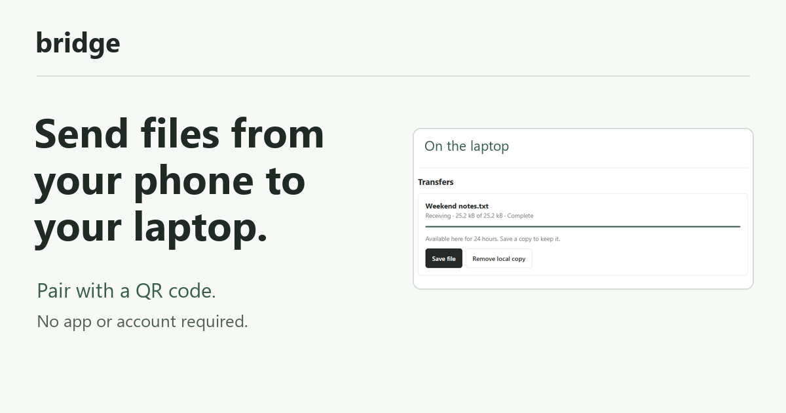

# Bridge

Send files and clipboard text between browsers without installing an app or creating an account. A Bridge room supports up to 20 devices including the host.

[Open Bridge](https://bridge-eight-beryl.vercel.app/) · [Phone-to-laptop guide](https://bridge-eight-beryl.vercel.app/guide/)

[](https://bridge-eight-beryl.vercel.app/)

1. On the laptop, select **Create a room** and keep the host tab open.
2. Scan the QR code with your phone and confirm the matching symbols on both screens.
3. Choose a recipient under **Send to**, open **Files**, and select what to send. The recipient can save the download.

Other devices can scan the same QR code. Guests can select **Connect** beside another guest and verify the matching symbols on both devices to share directly. Clipboard text can also be sent to all of your verified connections. Touch & sign works with the selected device.

**Files** streams encrypted files and folders to browser storage. Folders download as ZIP archives. **Clipboard** sends text and links. **Touch & sign** turns the paired phone into a PDF slide remote or a signature pad. Camera scanning is available for pairing.

## Run locally

```sh
npm install
npm run dev
```

Open `http://localhost:5173`. Create a connection, copy its pairing link into a second browser window, and confirm the symbols on **both** screens. You can then send text and links, copy received entries, or explicitly read your clipboard. Clipboard access requires browser permission. Optional focus sync is off by default. The desktop/companion toggle changes the layout for testing.

```sh
npm run build
npm test
```

## Use on a phone / deploy

Serve the Vite build and reverse-proxy `/signal` to the Node server behind **HTTPS/WSS**. Localhost is a secure-context exception; opening an HTTP LAN IP on a phone is not. The QR uses the current page origin, so load the desktop page through the same HTTPS address reachable from the phone. `npm run server` starts the relay. Set `NODE_ENV=production`, `ALLOWED_ORIGINS` to an explicit comma-separated allowlist, and optionally `PORT` (default 8787). The relay refuses production startup without the allowlist.

Rooms use direct WebRTC by default, with Cloudflare public STUN for discovery. Room clients only accept STUN entries from `VITE_ICE_SERVERS`. For TURN fallback, first configure a hard cutoff at your TURN provider to disable relay credentials at the free allowance. Then set `BRIDGE_QUOTA_MANAGED_TURN=true` on the signaling server and configure `TURN_CLIENT_CONFIG` or `TURN_URLS` and `TURN_SHARED_SECRET`. The provider enforces the quota. Devices that need TURN will fail to connect if it is disabled or its allowance is exhausted.

Set the Vercel Production Config variable `VITE_RELAY_URL` to the signaling endpoint (`wss://.../signal`). The frontend also accepts the older `VITE_SIGNAL_URL` name.

## Structure

- `src/App.tsx`, `src/style.css`: responsive light/dark utility interface.
- `src/lib/bridge.ts` and `src/lib/peerLink.ts`: room lifecycle and independently verified encrypted links.
- `src/lib/crypto.ts`: ephemeral identities, session derivation, authenticated encryption.
- `src/components/Scanner.tsx`: rear-camera QR scanning with jsQR.
- `src/store/session.ts`: in-memory session and bounded clipboard history.
- `src/store/transfers.ts`: transfer progress and received download references.
- `server/`: signaling rooms capped at 20 devices with idle-invite expiry, size and rate limits.
- `tests/`: key agreement, tampering/context isolation, and relay integration tests.

## Security and scope

Public host keys travel in the QR URL fragment. Private keys stay in the tab. Each pair checks the full four-symbol code before sharing. Encryption uses random 96-bit IVs, pair- and direction-bound authenticated context, and per-direction replay counters. The signaling connection stays open for new joins and carries only membership and WebRTC setup messages. Session history holds at most 50 entries of 12,000 characters and clears when you leave or reload.

Compare all four symbols before confirming the connection. Clipboard history is session-only. Completed downloads can be reopened from local browser storage for 24 hours. After a disconnect, create a fresh pairing session.

Cryptographic API reference: [MDN Web Crypto key derivation](https://developer.mozilla.org/en-US/docs/Web/API/SubtleCrypto/deriveKey).
